<p align="center"></p>

# KratonOS (`v2026.6`) — Autonomous Treasury & Policy Vault on NEAR Protocol

KratonOS (`v2026.6`) is a self-custodial, hardware-attested autonomous treasury, policy vault, cross-chain execution engine, and multi-agent coordination system built on NEAR Protocol v88, released under the **MIT License** (see [`LICENSE`](./LICENSE)).

**Primary Live Deployment & Machine-Readable Specification Links:**
- **Live Production App (Vercel)**: https://kraton-os-taupe.vercel.app
- **Live Standalone Documentation Portal (`/docs`)**: https://kraton-os-taupe.vercel.app/docs
- **Live AI Judge Index (`/llms.txt`)**: https://kraton-os-taupe.vercel.app/llms.txt
- **Live OpenAPI 3.1 Specification (`/openapi.json`)**: https://kraton-os-taupe.vercel.app/openapi.json
- **Official GitHub Repository**: https://github.com/jubayir-hub-69/KratonOS

*(See Section 8 at the bottom of this document for the Official Protocol, All 13 Track Prompts, Explorer & Contract Reference Directory.)*

---

## 1. What KratonOS Is & The Problem It Solves (Plain English for a Bookkeeper)

When a company, startup, or DAO pays global contributors, rebalances treasury reserves, or hires AI agents across multiple blockchains, bookkeepers and finance teams face four recurring failures:

1. **AI Agents Cannot Be Trusted with a Master Bank/Wallet Key**: Giving an AI agent a Full-Access private key means a single prompt injection or hallucinated price can drain the entire treasury.
2. **Freelancers Receive Less Than Their Invoice Due to Hidden Bridge/Swap Fees**: Sending $250.00 across chains usually deducts variable bridge and AMM fees from the recipient, leaving them with $248.30 and breaking accounting reconciliation.
3. **One Bad Recipient Address Halts an Entire Payroll Batch**: In standard token batch scripts, if 1 out of 12 recipients is unregistered for NEP-141 storage or flagged as a scam address, the entire batch fails or funds are lost.
4. **Confidential Financial Statements Leak to Third-Party AI Servers**: Uploading raw treasury expense ledgers to standard cloud LLMs retains sensitive company data on external servers.

**How KratonOS Fixes This**:
- **Human-Defined Guardrails (`config.yaml`)**: A human treasurer sets hard rules once (`max_single_tx_usd: 150.00`, `daily_spend_limit_usd: 500.00`, `max_slippage_bps: 100`, `emergency_kill_switch: false`).
- **Hardware-Verified AI & Oracles (`PoC-4`)**: Before any transaction can execute, KratonOS requires four cryptographic proofs to match simultaneously: the human policy hash, a hardware-attested signature from NEAR AI Cloud (`zai-org/GLM-5.1-FP8` running in Intel TDX + NVIDIA H100 Hopper TEE), a live Ethereum Mainnet `eth_getProof` (EIP-1186) Chainlink state-root proof from an OutLayer WASI enclave, and a live `1Click` Confidential Private Shard quote.
- **Exact-to-the-Cent Invoicing & Fault-Isolated Payroll**: Bookkeepers import a standard `.csv` payroll file (`samples/sample-payroll-batch.csv`), KratonOS automatically pays the `0.00125 NEAR` token storage registration for new recipients, quarantines malicious/scam addresses without halting legitimate payouts, guarantees `100.00%` net invoice delivery via `BigInt` ceiling math, and exports a reconciled bookkeeper `.csv` ledger (`samples/exported-bookkeeper-ledger.csv`).

---

## 2. Before KratonOS vs After KratonOS (Measured Impact)

| Operational Metric | Before KratonOS (Manual / Standard Agent Scripts) | After KratonOS (`PoC-4` Autonomous Treasury & Policy Vault) | Source / Verification Command |
| :--- | :--- | :--- | :--- |
| **Cross-Chain Settlement Time** | ~2 hours (manual bridging + sequential signing) | **12–63 seconds** (4 parallel NEP-611 gas-key lanes) | `npm run verify:server` (`POST /api/demo/autonomous-loop`) |
| **Unregistered Recipient NEP-141 Failure Rate** | ~5% batch panic (`Smart contract panicked: account not registered`) | **0% failure** (probes `storage_balance_of` & prepends `0.00125 NEAR` `storage_deposit`) | `npm run verify:intents-rhea` (`src/core/payroll-and-invoicing.ts`) |
| **Stablecoin Cross-Chain Routing Fee (`USDC` $\rightarrow$ `USDT`)** | 30–50 bps AMM pool fee + curve slippage | **41 bps (`0.41%`)** total fee (`1 bp` `1Click` solver spread + `40 bps` protocol fee to `asma90.testnet`) | `npm run verify:intents-rhea` (`src/core/intents-rhea-router.ts`) |
| **Freelancer Cross-Chain Invoice Accuracy** | ~99.2%–99.7% (fees deducted from recipient payout) | **100.00%** (`BigInt` ceiling gross-up `execute_ceil_exact_output_invoice`) | `npm run verify:intents-rhea` (`INV-2026-KRATON01`) |
| **Master Key Exposure & Prompt-Injection Drain Risk** | 100% Full-Access key exposure to LLM context | **0% master key exposure** (`PoC-4` gate + scoped keys + `escalate_dao_proposal` on `jubayir69.testnet`) | `npm run verify:attack-demo` (`src/verify/verify-attack-demo.ts`) |
| **Multi-Agent Compute Procurement Cost (25 Sub-Accounts)** | $2.85/unit retail + high LLM negotiation token burn | **$2.15/unit** (**24.56% savings**, **0 LLM calls** via SHA-256 commit-reveal) | `npm run verify:ai-tee` (`src/core/swarm-coordinator.ts`) |

---

## 3. Core Architecture & The `PoC-4` Cryptographic Protocol

Every state-mutating operation in KratonOS is gated by the **Quad-Attested Proof of Constraint (`PoC-4`)** master commitment:

$$\text{H\_master} = \text{SHA256}\left(\text{Hash\_Policy} \parallel \text{Sig\_NEAR\_AI\_TEE} \parallel \text{RTMR3\_OutLayer\_EIP1186} \parallel \text{Address\_1Click\_Quote}\right)$$

- **Canonical `H_master` Digest (64-char SHA-256)**: `a9ada695b7f0859fe205c64a7f246b4851d82526002778ece337338e20ffb152`
- **Canonical `H_policy` Digest (`config.yaml`, 64-char SHA-256)**: `40b4ec314cdeec041edf22d20c4bb059ad9b288c055a4c8d463c57de1c3d68f6`

1. **Pillar 1 — Policy Vault, 4-Signal Scam Shield, NEP-611 Gas-Key Multiplexer & Post-Quantum (`ml-dsa-65`) Auditor**:
   - **Smart Contract Architecture**: `contracts/kratonos_vault.wasm` is a compiled 5,594-byte WebAssembly binary (`code_hash: 8c77LmtTQePG2oJSzqHq9itY1SSVHn3GiuqFK3Agt1PD`, `8,680` bytes storage) deployed to `jubayir69.testnet` (`DeployContract` tx `DfBfFVngYGN4WvzFrYXLirU1GU2TGtgHB6GzfcjX5MZG`, Block `#277645956`) exporting 12 callable methods (`init_vault`, `get_vault_state`, `compute_policy_hash`, `verify_poc4_enclave_gate`, `verify_and_anchor`, `anchor_poc4_batch`, `execute_payroll_row`, `escalate_dao_proposal`, `harvest_yield_sweep`, `settle_swarm_round`, `submit_limit_order`, `verify_x402_settlement`), while `contracts/kratonos-policy-vault/src/lib.rs` serves as the readable Rust reference specification alongside the TypeScript security engine (`src/core/poc4.ts`, `src/core/security-shield.ts`, `src/core/gas-keys.ts`).
   - **3-Tier Earned-Trust Governance**: `AUTO_APPROVE` $\le \$50.00$ ($\le \$150.00$ verified counterparty), `ONE_COUNCIL_FAST_TRACK` $\$50.01\text{--}\$150.00$, and Tier 3 (`> $150.00` single-tx or `> $500.00` daily) executing `FunctionCall(escalate_dao_proposal)` directly on the `jubayir69.testnet` Policy Vault contract with a `1.0000 NEAR` proposal bond (`TX: Dn1S4PjMxLeXX7EihmLLrLiPohv9cNFvEmhjnx7nUwoD`, Block `#277646089`), storing the proposal record in on-chain contract state and emitting a NEP-297 `EVENT_JSON` governance event rather than calling an external Sputnik DAO factory contract.
   - **NEP-611 Parallel Lanes**: The 4 sub-accounts (`scout.jubayir69.testnet`, `executor.jubayir69.testnet`, `payroll.jubayir69.testnet`, `yield.jubayir69.testnet`) operate as an off-chain deterministic nonce-isolation multiplexer (`100,000,001`..`400,000,001`) while on-chain transactions on Testnet are signed and settled by the primary vault account `jubayir69.testnet`.
2. **Pillar 2 — Dual-TEE Hardware Verification (`NEAR AI Cloud` + `OutLayer WASI P1/P2`) & Ethereum Mainnet `eth_getProof` Verifier**:
   - WASI Preview 1 & Preview 2 Rust crate (`enclave/outlayer-wasi/src/lib.rs`) + live verifier (`src/core/outlayer-enclave.ts`, `src/core/near-ai-tee.ts`).
   - Verifies live Ethereum Mainnet `eth_getProof` (EIP-1186) Merkle-Patricia Trie nodes (`keccak256(accountProof[0]) === block.stateRoot`) for Chainlink `ETH/USD` (`0x5f4eC3Df9cbd43714FE2740f5E3616155c5b8419`) across 5 independent Ethereum RPCs, plus 8-step NVIDIA NRAS Hopper GPU + Intel TDX 5-register (`MRTD`, `RTMR0..3`) attestation for `zai-org/GLM-5.1-FP8`.
3. **Pillar 3 — Tri-Venue Smart Router (`1Click` + `RHEA V1 AMM` + `RHEA V2 DCL`), Confidential Limit Orders (`/v0/orders`), RHEA Farming & MPC Chain Signatures**:
   - Implemented in `src/core/intents-rhea-router.ts` and `src/core/rhea-yield-and-mpc.ts`.
   - Routes protocol revenue (`app_fee_bps: 40` to `asma90.testnet` + `1 bp` 1Click stablecoin solver spread = `41 bps` (`0.41%`) total fee, strictly $\le 500\text{ bps}$ fee cap), enforces `"confidentiality": "basic"` on `/v0/orders` limit orders (`TX: 2gjqSVvRhZtVYV6LuA8MHFutXRfFT5TLB8feCrzyYpgD`, Block `#277646035`) with OutLayer Ed25519 VRF anti-MEV slicing, executes `harvest_yield_sweep` (`TX: ArNihHTyPzom5jHveNMcZSt3bkvzQCxFZUozfSpawT8v`, Block `#277645997`) on `jubayir69.testnet` dispatching a real on-chain cross-account transfer (`0.0500 NEAR`, child receipt `5MPert5BFEAUDdAaTkPkPWoRjLu4z1R3BANRZDB7zdt4`) to `wrap.testnet` while constructing the `ref-farming.testnet` `withdraw_reward({ amount: "0" })` action specification, and derives `EVM (0x...)`, `Bitcoin (Testnet / SegWit, tb1q...)`, `Solana (Devnet / Mainnet)`, `Zcash (t1...)`, and `TON (EQ...)` addresses via `v1.signer-prod.testnet`.
4. **Pillar 4 — `EXACT_OUTPUT` Ceiling Invoicing, Fault-Isolated Batch Payroll, `A2A + x402` (`v2`) Agent Market & 20x5 Sealed-Bid Swarm**:
   - Implemented in `src/core/payroll-and-invoicing.ts`, `src/core/agent-market.ts`, and `src/core/swarm-coordinator.ts`.
   - Executes 11 settled `FunctionCall execute_payroll_row` transactions (`8R2ztwbnYHCBnpB1WwVwdR1JHBtiEdHJimhn4K64i9ND` through `9iZT9gejZjm6gKAYfhWLpnWbnuA69fCWsXFbsshJh15b`) with cross-account `Promise::new(recipient_id).transfer(amount)` payouts totaling `2.6400 NEAR` across 7 verified recipients (`asma90.testnet`, `v1.signer-prod.testnet`, `outlayer.testnet`, `worker.outlayer.testnet`, `ref-finance.testnet`, `wrap.testnet`, `ref-farming.testnet`) while quarantining Row #12 (`unverified-quarantine-row12.testnet`, `0 NEAR`). Also verified on-chain: `verify_x402_settlement` (`TX: C1LfqHuH2Da43Zc1doayJvoaafbpvo9qhjPwKVK7gRz8`, Block `#277646053`) and `settle_swarm_round` (`TX: EJxJz6ta1hWbvFDxe135CoehKSXRr2dZXDNdnwX4Fmpx`, Block `#277646016`).

---

## 4. Mandatory Security & Privacy Disclosures (`06-security.md` & `03-privacy.md`)

### A. Scoped Function-Call Access Key Limits & Allowance Protocol Semantics
- **What a Function-Call Key Cannot Do**: On NEAR Protocol, a `FunctionCall` access key is restricted to calling specific `method_names` on a single `receiver_id` contract with zero attached NEAR token transfers (`Transfer`, `AddKey`, `DeleteKey`, `DeployContract`, and `DeleteAccount` actions are rejected at the protocol runtime level).
- **Account Lockout Hazard**: If an account holds *only* a `FunctionCall` access key and its gas allowance is exhausted (or the target contract is deleted), the account is permanently locked out because a `FunctionCall` key cannot call `AddKey` to rotate or replenish itself. KratonOS audits key inventories via `auditAccountSecurity()` (`src/core/security-shield.ts`) to ensure `jubayir69.testnet` retains a hardware/cold Full-Access recovery key while agents operate exclusively on scoped keys.
- **Host Call `0` vs External `AddKey` `null` Allowance Discrepancy**:
  - Inside a smart contract host call (`promise_batch_action_add_key_with_function_call`), passing `allowance = 0` means **unlimited** gas allowance.
  - In an external RPC transaction `AddKey` action, passing `allowance: 0` sets a **literal `0 yoctoNEAR` allowance**, causing the key to fail immediately on its first transaction with `NotEnoughAllowance`. External `AddKey` actions must pass `allowance: null` (or omit the field) for unlimited gas allowance. KratonOS enforces this check in `validateAddKeyAllowanceRule()` (`src/core/security-shield.ts`).

### B. NEP-611 Gas Keys, Burn Protection & Protocol v87 Meta-Transaction Rule
- **4 Parallel Nonce Lanes**: `Nep611GasKeyMultiplexer` (`src/core/gas-keys.ts`) partitions concurrent agent traffic across 4 isolated NEP-611 lanes (`0: scout`, `1: executor`, `2: payroll`, `3: yield`) with a `1.30x` (30%) buy-vs-burn gas pessimism buffer.
- **Prepaid Balance Burn Protection (`WithdrawFromGasKey` before `DeleteKey`)**: Deleting a NEP-611 Gas Key that still holds prepaid gas burns the balance (and fails if balance $> 1\text{ NEAR}$). `buildSafeGasKeyDeleteActions()` automatically prepends `WithdrawFromGasKey` before `DeleteKey`.
- **Protocol v87 Meta-Transaction Rule**: Per nearcore Protocol v87+, an inner `SignedDelegateAction` (NEP-366) **cannot** be signed by a NEP-611 Gas Key (`verifyProtocolV87MetaTxRule` blocks any Gas Key on inner delegate actions); inner `SignedDelegateAction` payloads for `x402` and gasless invoicing are signed with a standard `ed25519` access key, while only the relayer's outer transaction uses a Gas Key.

### C. Zero Server-Side Data Retention (`03-privacy.md`)
- In `executeZeroRetentionPrivateAudit()` (`src/core/near-ai-tee.ts`), KratonOS loads the sensitive treasury statement (`samples/sample-treasury-statement.json`) into a mutable `Buffer`, evaluates anomalies inside the attested `zai-org/GLM-5.1-FP8` TEE flow, clears the parsed array (`statement.lineItems.length = 0`), and **immediately overwrites the entire raw byte buffer in-place with zeroes (`mutableSensitiveBuffer.fill(0)`)** before returning the signed audit digest.
- The function scans every byte of `mutableSensitiveBuffer` post-wipe to assert `nonZeroBytesRemainingAfterWipe === 0` (`zeroRetentionVerified: true`). Nothing from the raw document is written to disk or retained in server memory.

### D. Post-Quantum NIST FIPS 204 `ml-dsa-65` Verification (`06-security.md`)
- `verify_mldsa65_domain_digest()` (`src/core/security-shield.ts` & `contracts/kratonos-policy-vault/src/lib.rs`) validates `1952`-byte NIST FIPS 204 `ML-DSA-65` public keys and `3309`-byte signatures, computing the canonical domain-separated digest `SHA3-256("near:ml-dsa-65-pubkey-hash:v1" || pubkey_1952_bytes)` formatted as `ml-dsa-65-hash:<base58>`.

### E. Autonomous Business Guardrails & Revenue Split (`04-business.md` -> `config.yaml`)
- **Daily Inference Spend Cap**: `max_daily_inference_spend_usd: 5.00` (enforced with an in-memory `<= 10 calls/minute` rate guard + SHA-256 prompt cache in `src/core/near-ai-tee.ts`).
- **Minimum Report / Task Price Floor**: `min_report_price_usd: 1.50` / `min_report_or_task_price_usd: 2.50`.
- **Autonomous Revenue Split (`70 / 20 / 10`)**: After deducting the `5%` platform fee and locking the `5%` SLA dispute bond on `market.near.ai`, net worker revenue is automatically split `70%` to `treasury_reserve`, `20%` to `sub_agent_bounty_pool`, and `10%` to `compute_refill_pool`.
- **Emergency Kill-Switch**: `emergency_kill_switch: false` in `config.yaml`, flippable at any time in the browser via the `HoldConfirmButton` (`900ms` press-and-hold, persisted per-user in `sessionStorage` so arming it immediately halts and disables all execution buttons across all 7 views in your browser session without disrupting other concurrent visitors/judges) or via `POST /api/policy/kill-switch`.

---

## 5. Reproducible "Do X $\rightarrow$ See Y" Verification Commands for Judges

KratonOS requires **zero manual configuration** to verify. If `.env` is present, it authenticates live against `NEAR AI Cloud`, `1Click`, and `market.near.ai`; if run in an unconfigured CI sandbox, it falls back cleanly to `.env.example` and verified cryptographic proof bundles in `samples/`. Full 38-assertion & 12-vector adversarial stress documentation is in [`STRESS.md`](./STRESS.md).

```powershell
# 1. Install dependencies & verify TypeScript compilation
npm install
npm run build
```

| Command ("Do X") | Expected Output ("See Y") |
| :--- | :--- |
| **`npm test`** | Runs the master verification suite (`src/verify/verify-all.ts`) across all 5 verification scripts + `.env` secret-hygiene audit and exits with **`STATUS: ALL 6 MASTER SUITES PASSED (EXIT 0)`**. |
| **`npm run verify:attack-demo`** | Runs the 4-Vector Live Attack Rejection & Security Demo (`src/verify/verify-attack-demo.ts`): blocks prompt injection + `unverified-quarantine-row12.testnet` (`decision: "block"`, score `100/100`), blocks over-limit `$450` spend and escalates to Sputnik DAO V2 (`1 NEAR` bond), blocks `8.42%` oracle manipulation (`> 5.0%` max), and dispatches 4 concurrent NEP-611 gas-key lanes with `0` nonce collisions + `ml-dsa-65-hash:` verification. |
| **`npm run verify:outlayer`** | Fetches a live Ethereum Mainnet block header across 5 RPCs, verifies Chainlink `ETH/USD` (`0x5f4e...8419`) via live `eth_getProof` (EIP-1186) Keccak-256 Merkle-Patricia Trie hashing (`stateRootMatches: true`, `storageHashMatches: true`), computes multi-source median prices (`ETH/USD`, `NEAR/USD`), verifies 5x48B Intel TDX registers + Ed25519 VRF anti-MEV slices, and writes/re-verifies `samples/outlayer-execution-proof.json`. |
| **`npm run verify:ai-tee`** | Runs the 8-Step NEAR AI Cloud (`zai-org/GLM-5.1-FP8`) hardware attestation verifier (`STATUS: TEE ATTESTATION VERIFIED / OFFLINE_SAMPLE_QUOTE_VERIFIED`), verifies Zero-Retention memory wipe (`2173 bytes overwritten with 0x00, 0 non-zero bytes remaining`), executes 1-round quote negotiation + `A2A + x402` (`x402Version: 2`) NEP-366 `SignedDelegateAction` hiring + `aat_` worker check (`TX: C1LfqHuH2Da43Zc1doayJvoaafbpvo9qhjPwKVK7gRz8`), and settles the 20-Buyer $\times$ 5-Seller Sealed-Bid Swarm round (`0 LLM calls`, `$357.00` saved, `TX: EJxJz6ta1hWbvFDxe135CoehKSXRr2dZXDNdnwX4Fmpx`). |
| **`npm run verify:intents-rhea`** | Fetches `210` live tokens from `GET /v0/tokens`, benchmarks `1Click` (`1 bp` stablecoin fee + `40 bps` app fee to `asma90.testnet` = `41 bps` total fee, `dry: true`) vs `RHEA V2 DCL` vs `RHEA V1 AMM` (`196` active pools on `ref-finance.testnet`), builds a `"confidentiality": "basic"` GTC limit order (`/v0/orders`, FunctionCall `submit_limit_order` `TX: 2gjqSVvRhZtVYV6LuA8MHFutXRfFT5TLB8feCrzyYpgD`), verifies `harvest_yield_sweep` `TX: ArNihHTyPzom5jHveNMcZSt3bkvzQCxFZUozfSpawT8v` (child receipt `5MPert5BFEAUDdAaTkPkPWoRjLu4z1R3BANRZDB7zdt4` to `wrap.testnet`) + `v1.signer-prod.testnet` multi-chain addresses (`EVM`, `BTC`, `SOL`, `ZEC`, `TON`), and runs `EXACT_OUTPUT` ceiling invoicing + 12-row fault-isolated batch payroll (`2.6400 NEAR` across 11 settled `execute_payroll_row` calls `8R2ztw...` through `9iZT9g...` across 7 verified recipients, row 12 quarantined, USD at the live NEAR/USD rate, `STATUS: PASS`). |
| **`npm run verify:server`** | Boots the full-stack server (`src/server/server.ts`), verifies `HTTP 200` on the KratonOS Web Dashboard (`/`, `/docs`, `/styles.css`, `/app.js`), `/api/overview`, `/api/policy/kill-switch`, `/api/security/evaluate`, `/api/payroll/export-csv`, `/api/payroll/export-statement` (Printable HTML/PDF Audit Statement), `/api/wallet/balances` (7-chain Testnet RPC wallet balance prober + Mainnet-Mismatch guard), `/api/onchain/receipt` (live NEAR Testnet RPC receipt inspector), `/llms.txt`, `/openapi.json`, `/api/onchain/commit-proof`, the Strict Anti-Hallucination TEE Market/News Co-Pilot (`ETH`, `NEAR`, `XRP`, `SOL`, `BTC`, `PEPE` 8-decimal precision + `UNLISTED_TOKEN` on `AYAN/USDT` + Levenshtein typo suggestion `AVEX -> AVAX`), and executes the 5-stage `/api/demo/autonomous-loop` in $< 120\text{ s}$. |
| **`npm start` / `npm run dev`** | Starts the **KratonOS Web Dashboard** at **`http://localhost:4173`** (Live on Vercel at **https://kraton-os-taupe.vercel.app**) and the **Standalone Documentation Portal (`/docs`)** (`http://localhost:4173/docs` / https://kraton-os-taupe.vercel.app/docs) with Dual-Mode 7-Chain Testnet Wallet Custody (`@hot-labs/near-connect`, Rabby/MetaMask Sepolia, Slush Sui Testnet, Phantom Solana, UniSat Bitcoin Testnet), interactive 5-Stage SVG architecture inspector, live endpoint explorer, `/llms.txt`, and `/openapi.json`. |

### Dual-Mode Multi-Chain Simultaneous Wallet Hub (`Mode A` Sandbox vs `Mode B` Testnet-Only Personal Wallet Hub)
- **Mode A — Disconnected / 1-Tap Judge Sandbox Mode (`jubayir69.testnet`)**: Default mode when opening the app without a browser wallet so automated AI judges (`Claude Code` / `Codex` per Hackathon Rule `Q-017`) and walletless human reviewers can evaluate all 7 views immediately against the live `jubayir69.testnet` sandbox vault.
- **Mode B — Simultaneous Multi-Chain Testnet Wallet Hub (`Rule Q-010` — `NEAR`, `EVM`, `Solana`, `Bitcoin`, `Sui / Slush`, `TON`, `XRP`)**: Users can connect multiple wallets across all 7 chain families simultaneously (`Meteor / HOT / MyNearWallet` on NEAR Testnet, `Rabby / MetaMask` on EVM Sepolia / Arbitrum Sepolia / Base Sepolia, `Phantom / Solflare` on Solana Testnet/Devnet, `UniSat / Xverse` on Bitcoin Testnet `tb1...`, `Slush / Sui Wallet / Nightly` via `@mysten/wallet-standard` on Sui Testnet, `Tonkeeper` on TON Testnet, and `Crossmark / GemWallet` on XRPL Testnet) without disconnecting previously connected chains:
  1. **Testnet-Only Custody & `"Please Switch to Testnet Mode"` Guard (`Rule Q-010`)**: Per Hackathon Rule `Q-010`, KratonOS **never** queries or exposes user Mainnet wallet balances and **never** broadcasts user transactions on Mainnet. If a connected wallet is on Mainnet (e.g., `.near` Mainnet account, EVM `0x1` Mainnet, Bitcoin `bc1...` Mainnet, Sui `"sui:mainnet"`, or TON `EQ...`/`UQ...`), KratonOS flags `isMainnetMismatch: true`, prompts **`[TESTNET MODE REQUIRED] ... Please switch to Testnet mode`**, and provides a 1-click **`Switch to Sepolia Testnet Mode`** (`wallet_switchEthereumChain` `0xaa36a7`) / **`unisat.switchNetwork("testnet")`** action while keeping read-only `1Click` cross-chain quote rates (`dry: true` per `Rule Q-007`) and Ethereum Mainnet `eth_getProof` Chainlink verification (`Rule Q-008`) available.
  2. **Chain-Specific Automatic Origin (`PAY TOKEN`) & Destination (`RECEIVE TOKEN`) Routing**: Selecting `ETH` or `USDC` on EVM routes Testnet balance checks and signature popups (`personal_sign`) to the connected EVM wallet (`Rabby / MetaMask`), while selecting `NEAR` or `wNEAR` as `RECEIVE TOKEN` automatically populates `DESTINATION RECIPIENT ACCOUNT / ADDRESS` with the user's connected NEAR `.testnet` wallet (`Meteor / HOT`).
  3. **Live Multi-Chain Testnet RPC Balance Sync (`POST /api/wallet/balances`) & Multi-Account Slush Sui Probing**: Queries real on-chain Testnet native (`NEAR`, `ETH`, `SOL`, `BTC`, `SUI`, `TON`, `XRP`) and Testnet stablecoin (`USDC`, `USDT`) balances via `rpc.testnet.near.org`, `Sepolia / Arbitrum Sepolia / Base Sepolia`, `api.testnet.solana.com` / `api.devnet.solana.com`, `mempool.space/testnet`, 3 Sui Testnet RPCs (`fullnode.testnet.sui.io:443`, `sui-testnet-rpc.publicnode.com`, `rpc-testnet.suiscan.xyz:443` with 66-char `0x` address normalization and multi-account Slush probing), `testnet.toncenter.com`, and `s.altnet.rippletest.net:51234` (reporting exact `0.00` when empty).
  4. **Spendable vs Total On-Chain Balance Math & 1Click Native Testnet Equivalence**: On NEAR Testnet accounts, KratonOS queries live `view_account` via NEAR Testnet RPC and computes both **Total On-Chain Balance** (`amount / 10^24` on `jubayir69.testnet` or connected `.testnet` account) and **Available (Wallet Spendable) Balance** (`totalNear` minus `storage_usage * 10^19 yoctoNEAR ≈ 0.0018 NEAR` storage stake and `0.20 NEAR` wallet gas reserve). In `Invoicing & Batch Payroll` and `Agent Market & Swarm`, connected Testnet wallets evaluate total spendable value via `1Click` Intents (`spendableUsd = walletUsdc + walletUsdt + (walletNativeBalance * liveNativeTokenPriceUsd)`).
  5. **Strict Insufficient-Testnet-Balance Locks, Explicit Re-Connect Permission Popups & On-Chain `txHash` Receipts**: Zero background spinners run on tab switch, and clicking `Disconnect` clears cached session authorization so re-connecting always triggers a fresh wallet permission/approval popup. Execution enforces: (a) Mainnet mismatch check (`[TESTNET MODE REQUIRED]`), (b) Testnet balance check (`[LOCKED] Insufficient Testnet Balance` whenever `inputAmount > availableTestnetBalance`), and (c) real browser wallet popup signing (`personal_sign` / `signMessage` / `sui:signPersonalMessage` / NEAR Tx), anchoring the signed proof on NEAR Testnet (`POST /api/onchain/commit-proof`) and rendering the clickable `https://testnet.nearblocks.io/txns/${txHash}` Explorer receipt.
  6. **Meteor Wallet Read-Only Connection Permission Notice**: When connecting via Meteor Wallet (`@hot-labs/near-connect`), Meteor displays `"This does not allow: Calling methods or signing transactions on your behalf"`. This is intentional security design: initial wallet connection is strictly read-only (account ID discovery only) and **never** creates a silent background access key. Every transaction, `NEP-413` intent, `x402` escrow authorization, or `RHEA` LP reward sweep triggers an explicit per-action signature popup inside your wallet.

---

## 5B. Standalone `/docs` Portal, Strict Anti-Hallucination Oracle & Live On-Chain Proof Anchor

1. **Standalone Documentation Portal (`/docs`, `/llms.txt`, `/openapi.json`)**:
   - Navigating to `http://localhost:4173/docs` (or clicking `Docs & API Spec` in the sidebar) opens a 100% standalone, full-viewport documentation portal (`src/ui/views-docs.tsx`) featuring:
     - **Interactive Animated 5-Stage SVG Architecture Pipeline**: Click any stage node (`1. Human Constraints` $\rightarrow$ `5. Confidential Execution`) to inspect its source file, cryptographic inputs/outputs, and verification command.
     - **In-Browser Verification Matrix (`Do X -> See Y`)**: Click **Run Check in Browser** on any row to execute live backend verification checks and view the JSON receipt inline.
     - **Interactive REST API Overview & Endpoint Explorer**: Test all 13 live REST endpoints (`Test Live ->`) and inspect `/llms.txt` and `/openapi.json` (OpenAPI `3.1.0`) in a dedicated modal drawer.
     - **1-Click `Copy Page Markdown`**: Every chapter includes a `Copy Page Markdown` button for AI agents (`Claude Code`, `Codex`) and judges.
2. **Strict Anti-Hallucination Multi-Source Price Oracle (`src/core/outlayer-enclave.ts`, `src/core/near-ai-tee.ts`)**:
   - Resolves real-time prices across **Coinbase Spot**, **1Click (`GET /v0/tokens`, 210 tokens)**, and **Kraken / CryptoCompare**.
   - **Never Invents `$1.00` Fallbacks**: Unknown or unlisted tickers (e.g., `AYAN/USDT`) return `found: false`, `priceUsd: null`, and `status: "UNLISTED_TOKEN"`, rendering an explicit `TOKEN NOT FOUND (UNLISTED)` badge.
   - **Levenshtein Edit-Distance Typo Detection (`AVEX -> AVAX`)**: Misspelled tickers (e.g., `AVEX/USDT`) are caught by `findClosestValidTicker()`, returning `suggestion: "AVAX"` with the live `AVAX/USDT` price right below it.
3. **On-Chain NEAR Testnet Proof Verifier (`POST /api/onchain/commit-proof`), RPC Receipt Inspector (`GET /api/onchain/receipt`) & Public Explorer Links**:
   - In Mode A (Sandbox), `commitPoc4ProofOnChain()` (`src/core/rpc.ts`) is strictly read-only and returns `status: "MODE_A_SANDBOX_VERIFIED"` referencing the historical `FunctionCall(verify_and_anchor)` receipt (`TX: 9ni3ei7Ta591SJpjnvGzi5wBBNB9rmYAjkGZiryqnsRu`, Block `#277646071`) on `jubayir69.testnet` (`https://testnet.nearblocks.io/txns/9ni3ei7Ta591SJpjnvGzi5wBBNB9rmYAjkGZiryqnsRu`), never falsely claiming a live broadcast without a connected wallet.
   - Public Explorer Verification Links:
     - Treasury Vault & Deployed Contract (`DfBfFVngYGN4WvzFrYXLirU1GU2TGtgHB6GzfcjX5MZG`, `code_hash: 8c77LmtTQePG2oJSzqHq9itY1SSVHn3GiuqFK3Agt1PD`, `8,680` bytes storage): `https://testnet.nearblocks.io/address/jubayir69.testnet`
     - Protocol Fee Recipient (`40 bps`): `https://testnet.nearblocks.io/address/asma90.testnet`
     - OutLayer Enclave: `https://testnet.nearblocks.io/address/outlayer.testnet`
     - RHEA DEX & Farming: `https://testnet.nearblocks.io/address/ref-finance.testnet` & `https://testnet.nearblocks.io/address/ref-farming.testnet`
     - Chain Signatures MPC: `https://testnet.nearblocks.io/address/v1.signer-prod.testnet`
     - Chainlink ETH/USD Proxy: `https://etherscan.io/address/0x5f4eC3Df9cbd43714FE2740f5E3616155c5b8419`

---

## 6. Open-Source Libraries, Original Engineering & Cross-Repository Disclosures (`Q-005` & `Q-015`)

### A. Open-Source Libraries & Rust Crates Used (`package.json` & `Cargo.toml`)
- `@defuse-protocol/one-click-sdk-typescript` (`^0.1.26`) — Official NEAR Intents 1Click TypeScript SDK
- `@hot-labs/near-connect` (`^0.12.0`) — Official zero-dependency sandboxed NEAR Wallet Connector
- `viem` (`^2.57.4`) — Keccak-256, RLP encoding, ECDSA `secp256k1` signer recovery, and EIP-1559 transaction serialization
- `react` (`^19.0.0`), `react-dom` (`^19.0.0`), `lucide-react` (`^1.16.0`), `tailwindcss` (`^4.2.2`) — Frontend UI primitives
- `yaml` (`^2.7.0`) & `dotenv` (`^16.4.7`) — Human constraint (`config.yaml`) and environment loader
- `typescript` (`^5.7.3`) & `tsx` (`^4.19.3`) — Strict TypeScript compiler and execution engine
- Rust `1.86.0` Crates: `near-sdk` (`5.7.0`, `features = ["legacy"]`), `sha2` (`0.10`), `sha3` (`0.10`), `ed25519-dalek` (`2.1`), `bs58` (`0.5`), `serde` (`1.0`), `serde_json` (`1.0`)
- Official NEAR & Partner Agent Skills (`.agents/skills/`): `near-intents`, `near-ai-cloud`, `near-api-js`, `near-dapp`, `near-kit`, `near-smart-contracts`, `outlayer-custody`, `agent-market-worker`, `agent-market-buyer`, `agent-market-x402`

### B. Original KratonOS Engineering Written Specifically for This Project
- **`contracts/kratonos_vault.wasm` & `contracts/kratonos-policy-vault/src/lib.rs`**: `contracts/kratonos_vault.wasm` is the compiled 5,594-byte WebAssembly binary (`code_hash: 8c77LmtTQePG2oJSzqHq9itY1SSVHn3GiuqFK3Agt1PD`, `8,680` bytes storage) deployed to `jubayir69.testnet` at `DeployContract` tx `DfBfFVngYGN4WvzFrYXLirU1GU2TGtgHB6GzfcjX5MZG` exporting 12 callable methods, while `contracts/kratonos-policy-vault/src/lib.rs` serves as the readable Rust reference specification.
- **`enclave/outlayer-wasi/src/lib.rs`**: OutLayer WASI Preview 1 & Preview 2 Rust enclave module for Ed25519 VRF anti-MEV slicing and EIP-1186 proof binding.
- **`src/core/*` (`11` Core TypeScript Engines)**:
  - `src/core/poc4.ts`, `src/core/security-shield.ts`, `src/core/gas-keys.ts`, `src/core/rpc.ts` (including live Borsh + Ed25519 `commitPoc4ProofOnChain`)
  - `src/core/outlayer-enclave.ts` (live Ethereum Mainnet `eth_getProof` EIP-1186 RLP Merkle-Patricia Trie verifier + Strict Anti-Hallucination Multi-Source Oracle with Levenshtein typo detection)
  - `src/core/near-ai-tee.ts` (8-Step NEAR AI Cloud `GLM-5.1-FP8` NRAS + Intel TDX verifier + Zero-Retention `0x00` memory wipe)
  - `src/core/intents-rhea-router.ts` & `src/core/rhea-yield-and-mpc.ts` (Tri-Venue `1Click` / `RHEA V2 DCL` / `RHEA V1 AMM` router, `/v0/orders` confidential limit orders, `withdraw_reward({ amount: "0" })` farming sweep, and 5-chain MPC KDF)
  - `src/core/payroll-and-invoicing.ts`, `src/core/agent-market.ts`, `src/core/swarm-coordinator.ts` (`EXACT_OUTPUT` ceiling invoicing, 12-row fault-isolated NEP-141 batcher, `x402 v2` escrow, and 20x5 SHA-256 commit-reveal swarm)
- **`src/server/server.ts` & `src/ui/*`**: Full-stack HTTP + Vercel Serverless API (`13` OpenAPI 3.1 endpoints + `/llms.txt` + `/openapi.json`), Dual-Mode Multi-Chain Wallet Controller (`src/ui/wallet-controller.ts`), 7-View KratonOS Web Dashboard (`src/ui/App.tsx`, `src/ui/views-core.tsx`, `src/ui/views-business.tsx`), and Standalone Documentation Portal (`/docs`) (`src/ui/views-docs.tsx`).

### C. Hackathon Submission Disclosure (Rule `Q-015`)
- **Builder / GitHub Account**: **Jubayir Haider** (https://github.com/jubayir-hub-69)
- **Single Standalone Submission (`1 of 1` Project Submitted by This Builder)**: **KratonOS** — https://github.com/jubayir-hub-69/KratonOS (Live: https://kraton-os-taupe.vercel.app) — Quad-Attested Autonomous Treasury, Policy Vault, Multi-Venue Intents Router & Agent Operating System on NEAR Protocol. No companion or secondary project is submitted by this builder.

---

## 7. Honest Scope, Live vs Dry-Run Boundary & Intentional Non-Goals

See [`STRESS.md`](./STRESS.md) (and `/docs#stress`) for the full **6-Suite, 38-Assertion, 12-Attack-Vector Stress Matrix**. Every runtime boundary is transparently classified below:

| Subsystem / Capability | 100% Live Network Execution | Testnet / Dry-Run Boundary & Intentional Non-Goals |
| :--- | :--- | :--- |
| **Dual-Mode Wallet Custody (`Mode A` `Q-017` vs `Mode B` `Q-010`)** | **Mode B (Connected 7-Chain Testnet Wallet Hub, `Q-010`)**: Connecting across all 7 chains (`NEAR .testnet`, `EVM Sepolia / Arbitrum Sepolia / Base Sepolia`, `Solana Testnet/Devnet`, `Bitcoin Testnet tb1...`, `Sui Testnet / Slush`, `TON Testnet`, `XRPL Testnet`) queries strictly real Testnet RPC balances (`POST /api/wallet/balances` — exact `0.00` when empty, never querying Mainnet balances), blocks Mainnet sessions with `[TESTNET MODE REQUIRED] Please switch to Testnet mode`, enforces `inputAmount > availableTestnetBalance` locks, requires real browser wallet popup signatures (`personal_sign` / `signMessage` / `sui:signPersonalMessage` / NEAR Tx), and commits on-chain NEAR Testnet proof receipts (`txHash`). | **Mode A (Judge Sandbox Default, `Q-017`)**: When no personal browser wallet is connected, the app operates on the explicitly badged **`Protocol Sandbox Vault (jubayir69.testnet)`** so headless AI judges (`Claude Code` / `Codex`) and walletless reviewers can evaluate every workflow immediately without extension popups. |
| **NEAR Testnet RPC & 31 Verified On-Chain Transactions** | Live `view_account` (`storage_usage: 8,680 bytes`, `code_hash: 8c77LmtTQePG2oJSzqHq9itY1SSVHn3GiuqFK3Agt1PD`), `EXPERIMENTAL_tx_status`, and 31 real on-chain transactions on `jubayir69.testnet` (1 `DeployContract` `DfBfFVngYGN4WvzFrYXLirU1GU2TGtgHB6GzfcjX5MZG` + 30 `FunctionCall` transactions including 11 `execute_payroll_row` cross-account transfers `8R2ztw...`..`9iZT9g...`). | In Mode A (Sandbox), `POST /api/onchain/commit-proof` is strictly read-only and returns `status: "MODE_A_SANDBOX_VERIFIED"` referencing historical receipt `9ni3ei7Ta591SJpjnvGzi5wBBNB9rmYAjkGZiryqnsRu`. Tier 3 governance executes `FunctionCall(escalate_dao_proposal)` (`Dn1S4PjMxLeXX7EihmLLrLiPohv9cNFvEmhjnx7nUwoD`) directly on `jubayir69.testnet` rather than calling an external Sputnik DAO factory contract. |
| **Ethereum Mainnet EIP-1186 & Price Oracles** | Live `eth_getBlockByNumber` + `eth_getProof` across 5 Ethereum Mainnet RPCs verifying Chainlink `ETH/USD` (`0x5f4e...8419`) RLP Keccak-256 tries locally, plus live Coinbase Spot, 1Click (`210` tokens), and Kraken quotes. | Unlisted tickers strictly return `priceUsd: null` (`UNLISTED_TOKEN`) with Levenshtein typo suggestions (`AVEX -> AVAX`), never a fabricated `$1.00` fallback. |
| **NEAR AI Cloud (`GLM-5.1-FP8`) TEE** | Live `https://cloud-api.near.ai/v1` inference, NRAS Hopper GPU + Intel TDX 5x48B hardware quote verification, ECDSA `secp256k1` recovery, and in-place `0x00` memory wipe. | Capped by `max_daily_inference_spend_usd: 5.00` and `<= 10 calls/min` rate guard in `config.yaml` to prevent runaway cloud inference spend. |
| **1Click Cross-Chain Swaps (`Q-007`)** | Live authenticated `GET /v0/tokens` (`210` assets) and `POST https://1click.chaindefuser.com/v0/quote` with inspectable pre-sign NEP-413 `token_diff` payloads. | **`dry: true` by Design (`Q-007`)**: Live `1Click` Mainnet quote calls pass `dry: true` (`40 bps` protocol fee + `1 bp` stablecoin solver spread = `41 bps` total fee) so judges and automated CI suites can benchmark real routes without locking Mainnet capital in ephemeral deposit addresses. |
| **Chain Signatures MPC (`Q-010`)** | Live on-chain `view_account` codeHash verification of `v1.signer-prod.testnet` and deterministic SHA3-256 epsilon KDF deriving `EVM`, `Bitcoin (Testnet / SegWit)`, `Solana (Devnet / Mainnet)`, `Zcash`, and `TON` custody addresses. | **Testnet-First Signer (`Q-010`)**: Anchored to `v1.signer-prod.testnet` so judges can rotate derivation paths and inspect valid EIP-1559 signing payloads safely without risking Mainnet custody funds. |
| **NIST FIPS 204 `ML-DSA-65` Post-Quantum** | Generates and verifies standard `1,952`-byte lattice public keys, `3,309`-byte signatures, and domain-separated `ml-dsa-65-hash:<base58>` (`SHA3-256`) commitments. | **Host Precompile Boundary**: Until nearcore lands native gas-metered WASM lattice precompiles, full `ML-DSA-65` lattice verification executes in the off-chain/enclave gate while the Policy Vault verifies the `SHA3-256` commitment digest on-chain. |
| **NEP-611 Parallel Lanes & Recursive Delegation** | 4-lane NEP-611 nonce-isolation multiplexer (`scout`, `executor`, `payroll`, `yield`) with isolated nonces (`100,000,001`..`400,000,001`). | The 4 sub-accounts (`scout.jubayir69.testnet`, `executor.jubayir69.testnet`, `payroll.jubayir69.testnet`, `yield.jubayir69.testnet`) operate as an off-chain deterministic nonce-isolation multiplexer while on-chain transactions on Testnet are signed and settled by the primary vault account `jubayir69.testnet`. Sub-agents cannot call `AddKey` or spawn child agents. |

---

## 8. Official Protocol, All 13 Track Prompts, Explorer & Contract Reference Directory

| Resource / Protocol | Official URL / Explorer Link |
| :--- | :--- |
| **Live Production Deployment (Vercel)** | https://kraton-os-taupe.vercel.app |
| **Live Standalone Documentation Portal (`/docs`)** | https://kraton-os-taupe.vercel.app/docs |
| **Live AI Judge Index (`/llms.txt`)** | https://kraton-os-taupe.vercel.app/llms.txt |
| **Live OpenAPI 3.1 Specification (`/openapi.json`)** | https://kraton-os-taupe.vercel.app/openapi.json |
| **Official GitHub Repository** | https://github.com/jubayir-hub-69/KratonOS |
| **Hackathon Submission Status (`Q-015`)** | Single Standalone Submission (`1 of 1` project submitted by Jubayir Haider) |
| **Official NEAR Hackathon Rules** | https://nearhackathon.com/HACKATHON.md · https://nearhackathon.com |
| **Official Track Prompts Repository** | https://github.com/nearai/near-hackathon-prompt-examples |
| **Official 13 Track Specifications (`01`–`13`)** | [01-defi.md](https://github.com/nearai/near-hackathon-prompt-examples/blob/main/tracks/01-defi.md) · [02-thesis.md](https://github.com/nearai/near-hackathon-prompt-examples/blob/main/tracks/02-thesis.md) · [03-privacy.md](https://github.com/nearai/near-hackathon-prompt-examples/blob/main/tracks/03-privacy.md) · [04-business.md](https://github.com/nearai/near-hackathon-prompt-examples/blob/main/tracks/04-business.md) · [05-swarms.md](https://github.com/nearai/near-hackathon-prompt-examples/blob/main/tracks/05-swarms.md) · [06-security.md](https://github.com/nearai/near-hackathon-prompt-examples/blob/main/tracks/06-security.md) · [07-agents.md](https://github.com/nearai/near-hackathon-prompt-examples/blob/main/tracks/07-agents.md) · [08-realworld.md](https://github.com/nearai/near-hackathon-prompt-examples/blob/main/tracks/08-realworld.md) · [09-games.md](https://github.com/nearai/near-hackathon-prompt-examples/blob/main/tracks/09-games.md) · [10-nfts.md](https://github.com/nearai/near-hackathon-prompt-examples/blob/main/tracks/10-nfts.md) · [11-memecoins.md](https://github.com/nearai/near-hackathon-prompt-examples/blob/main/tracks/11-memecoins.md) · [12-social.md](https://github.com/nearai/near-hackathon-prompt-examples/blob/main/tracks/12-social.md) · [13-open.md](https://github.com/nearai/near-hackathon-prompt-examples/blob/main/tracks/13-open.md) |
| **NEAR Protocol Documentation** | https://docs.near.org/ |
| **NEAR Intents / 1Click Mainnet API & Explorer** | https://1click.chaindefuser.com (`/v0/tokens`, `/v0/quote`, `/v0/deposit/submit`, `/v0/status`, `/v0/orders`) · https://explorer.near-intents.org/api/v0/transactions · https://docs.near-intents.org/ |
| **NEAR AI Cloud (Confidential H100 + Intel TDX TEE)** | https://cloud-api.near.ai/v1 (`model: "zai-org/GLM-5.1-FP8"`, `/v1/chat/completions`, `/v1/attestation/report`, `/v1/signature/{chat_id}`) · https://cloud.near.ai · https://docs.near.ai/ |
| **NEAR Agent Market (`A2A + x402` v2)** | https://market.near.ai (`/v1/agents`, `/v1/jobs`, `/v1/wallet/balance`) · https://docs.market.near.ai/ |
| **OutLayer Verifiable WASI P1/P2 Enclave** | https://outlayer.ai/ · https://app.outlayer.ai/docs/getting-started · https://testnet.nearblocks.io/address/outlayer.testnet · https://testnet.nearblocks.io/address/worker.outlayer.testnet |
| **RHEA Finance (V1 AMM + V2 DCL + Farming)** | https://rhea.finance/ · https://guide.rhea.finance/ · https://testnet.nearblocks.io/address/ref-finance.testnet · https://testnet.nearblocks.io/address/ref-farming.testnet |
| **Wallet Connection (`@hot-labs/near-connect`)** | https://docs.hotdao.ai/ |
| **Sputnik DAO V2 & Trezu Multisig** | https://github.com/near-daos/sputnik-dao-contract · https://trezu.org/ |
| **NEAR Chain Signatures MPC & Vault Accounts** | https://testnet.nearblocks.io/address/v1.signer-prod.testnet · https://testnet.nearblocks.io/address/jubayir69.testnet (Treasury Vault) · https://testnet.nearblocks.io/address/asma90.testnet (Protocol Fee & Settlement Recipient) |
| **Ethereum Mainnet Chainlink ETH/USD Aggregator** | https://etherscan.io/address/0x5f4eC3Df9cbd43714FE2740f5E3616155c5b8419 |

---

## 9. License

Released under the **MIT License** (`v2026.6`) — see [`LICENSE`](./LICENSE) for full license text.


